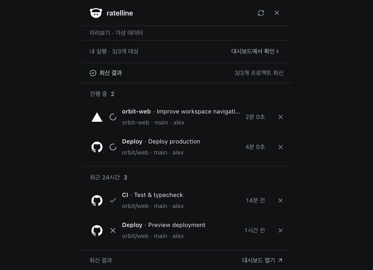
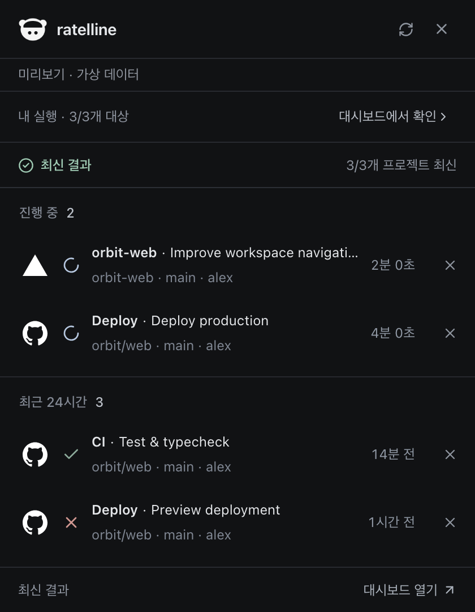
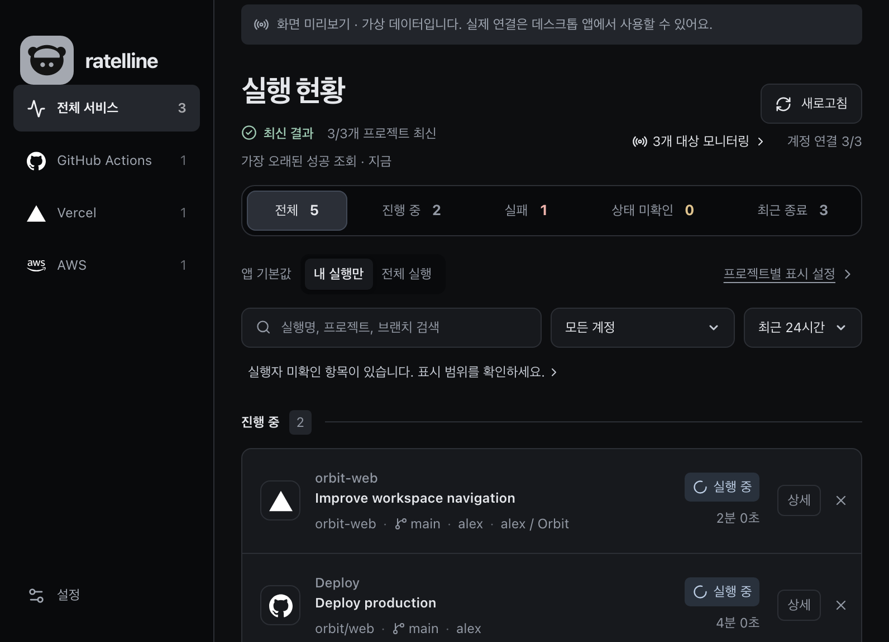
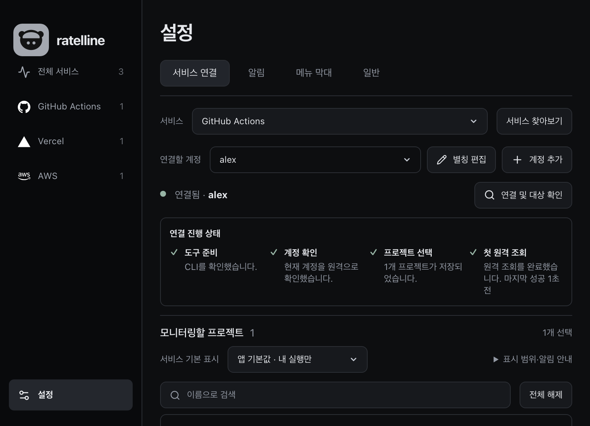
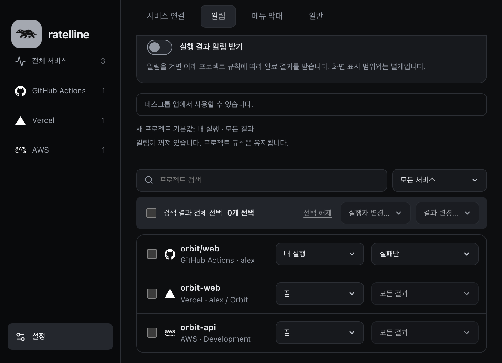

# ratelline

[English](README.md) · [한국어](README.ko.md) · [日本語](README.ja.md) · 简体中文

[](https://github.com/likeratel/ratelline/actions/workflows/verify.yml)


ratelline 是在菜单栏和系统托盘中无畏巡视部署线的监视者。名字来自蜜獾（ratel）——被蜜蜂蜇几下也绝不退缩。失败的部署不会被隐藏，而是和成功一样直接显示。通过摘要面板快速查看最近的执行记录，在仪表板中连接账号、搜索历史并设置通知。应用使用 Tauri 2、React、TypeScript 和 Rust 构建，所有服务查询都在本机进行。界面默认跟随系统语言，支持简体中文、英语、韩语和日语。

> 与 AI 一起完成。方向由我决定，集成也是用我自己的账号验证的；代码、测试和文档则是在与 [Claude Code](https://claude.com/claude-code) 的会话中编写的。参见[为什么做这个](#为什么做这个)。

**下载：** 已签名并公证的 macOS 版本（Apple Silicon 和 Intel）见 [Releases 页面](https://github.com/likeratel/ratelline/releases/latest)。参见[安装](#安装)和[快速开始](#快速开始)。Windows 安装包尚未发布。

> **验证范围。** GitHub Actions、Vercel 和 Bitbucket Cloud 已使用真实账号验证。其他服务仅依据官方 CLI/API 文档，使用虚构数据完成命令契约测试，未经真实账号验证。详见[服务验证记录](docs/provider-verification.md)和 [2026-10-06 产品评审](docs/product-review-2026-10-06.md)。

## 为什么做这个

我的部署分散在 GitHub Actions、Vercel、AWS 和 Bitbucket 上，想知道最后一次推送是否上线，得打开四个仪表板。我需要一个菜单栏应用：一眼给出答案，把失败的执行和成功的一样直接显示，并且永远不把令牌放到我自己的电脑之外。它最初叫 crowline（电线上的乌鸦），蜜獾成为吉祥物后改名为 ratelline，因为那正是我希望部署监视者具备的态度。

我做的事：确定支持的服务和只读范围，用真实账号验证了 GitHub Actions、Vercel 和 Bitbucket Cloud，其余服务只以契约测试约束而不夸大支持，并且每一项改动都经过独立审查后再提交。实现、测试和这些文档由 Claude Code 编写；蜜獾插画由提示词生成，再手工组合成图标。

## 界面预览

菜单栏面板 → 查看部署状态 → 按服务筛选 → 连接账号 → 设置项目通知。



使用虚构项目和账号，在应用的浏览器预览中录制，界面语言为韩语。演示不包含真实部署或通知推送。

<details>
<summary>查看更多截图</summary>

**菜单栏面板** — 快速查看运行状态、分支和触发人。



**仪表板** — 集中查看正在运行的任务和最近的结果。



**账号连接** — 选择服务和账号，设置需要监控的项目。



**通知** — 为每个项目选择关注谁的执行记录，以及接收哪些结果。



</details>

## 安装

需要 macOS 12 或更高版本，支持 Apple Silicon 或 Intel。未发布 Windows 或 Linux 安装包。Windows 可从源码构建（参见[开发](#开发)）；Linux 构建未经验证。

1. 从 [Releases 页面](https://github.com/likeratel/ratelline/releases/latest)下载最新的 `ratelline_<version>_universal.dmg`。每个版本都会列出该文件的 SHA-256；可用 `shasum -a 256 <file>.dmg` 校验。
2. 打开 DMG，将 **ratelline** 拖到 **应用程序**。
3. 从“应用程序”打开 ratelline。应用已使用 Developer ID 签名并经过公证，因此 macOS 无需绕过安全提示即可打开。它只在菜单栏中运行，不显示 Dock 图标。
4. 为每个要监控的服务安装并登录官方 CLI。ratelline 不捆绑任何服务商工具，也不保存 CLI 凭据。

| 服务 | CLI | 登录 |
| --- | --- | --- |
| GitHub Actions、GitHub Deployments | `gh` | `gh auth login` |
| Vercel | `vercel` | `vercel login`，或在应用中点击 **通过浏览器登录** |
| AWS | `aws`（v2） | `aws configure` 或 `aws sso login --profile <name>`；应用可为某个配置文件启动 SSO 登录 |
| Railway / Netlify / Render / Heroku | `railway` / `netlify` / `render` / `heroku` | `<cli> login` |
| Fly.io | `fly` 或 `flyctl` | `fly auth login` |
| GitLab.com | `glab` | `glab auth login` |
| DigitalOcean | `doctl` | `doctl auth init` |
| Google Cloud、Firebase | `gcloud` | `gcloud auth login` |
| Azure App Service | `az` | `az login` |
| EAS / Expo | `eas` | `eas login` |
| Bitbucket Cloud、Cloudflare | 无 | 在应用中输入 API 令牌；参见[已支持的监控](#已支持的监控) |

从 Finder 或登录时启动的应用不会继承 shell 的 `PATH`，因此会在 `PATH`、常见安装目录（Homebrew、`~/.local/bin`、npm/pnpm/Volta 全局目录、asdf/mise shims）以及 `$NVM_DIR`（默认 `~/.nvm`）下的 nvm Node 版本中查找 CLI：先查 `default` 别名，再按从新到旧的顺序查其他已安装版本。找到的 CLI 运行时会把它自己所在目录放在 `PATH` 最前面，因此通过 nvm 安装的 Node CLI 会使用匹配的 `node`。其他版本管理器（fnm、nodenv、n）需要把 CLI 以及（对基于 Node 的 CLI）`node` 链接到上述目录之一，例如 `~/.local/bin`。默认别名匹配并不覆盖所有 nvm 别名形式；无法解析的别名会回退到最新的已安装版本。

### 更新

未配置自动更新。更新时，右键点击菜单栏图标并选择 **退出**，下载较新的 DMG，并替换“应用程序”中的应用。设置、连接和通知规则会保留。从 crowline 升级时，请先安装 ratelline 并启动一次以复制设置，然后删除 `/Applications/crowline.app`。

### 卸载

1. 退出 ratelline，删除 `/Applications/ratelline.app`。
2. 如需同时删除设置和已保存的 Bitbucket、Cloudflare 令牌，请删除 `~/Library/Application Support/io.ratelline.desktop`；如果是从 crowline 升级的，也请删除同一文件夹中的 `io.crowline.desktop`。CLI 登录属于各个 CLI，不会受影响。

## 快速开始

1. **打开面板。** 点击菜单栏中的蜜獾查看最近的执行记录。右键点击它可选择 **显示面板**、**打开仪表板**、**刷新** 和 **退出**。
2. **连接服务。** 打开仪表板，进入 **设置 → 服务连接**，选择服务并连接账号。对于 CLI 服务，请选择已登录该 CLI 的账号。
3. **选择项目。** 搜索并选择要监控的项目或仓库。选择立即生效。
4. **选择显示谁的运行。** 按服务或项目设置 **我的运行** 或 **所有运行**。执行者未知的运行只出现在 **所有运行** 中。
5. **设置通知。** 在 **设置 → 通知** 中，为每个项目选择 **关闭 / 我的运行 / 所有运行**，再选择哪些结果会通知你。系统询问时，请在 macOS 中允许 ratelline 发送通知。
6. **调整菜单栏。** 在 **设置 → 菜单栏** 中，选择显示的服务和项目、每个区域的行数，以及有运行进行中时蜜獾是否走动。

下面各节会详细说明每个步骤。

## 连接账号和选择项目

打开 **设置 → 服务连接**，选择服务并连接账号，再选择要监控的项目。项目选择立即生效；通过账户旁的“编辑别名”修改名称后，点击保存并查看完成状态。 可一次性全选或取消选择当前搜索结果，不会改变被搜索条件隐藏的项目或其他账号的选择。

显示范围按应用默认 → 服务 → 项目继承，项目设置优先。“我的运行 / 所有运行”同时应用于仪表板、历史和菜单栏，通知规则独立。新监控项目默认启用“我的运行 · 所有结果”通知规则，不改变现有规则和全局通知开关。别名使用保存和取消按钮，并显示保存完成状态。批量选择按钮在“全选 / 取消全选”之间切换，仅作用于当前搜索结果。[服务验证记录](docs/provider-verification.md)区分命令契约测试与真实账户查询。

GitHub 使用已安装的 `gh` CLI。运行 `gh auth login` 后，为每个连接选择 CLI 用户。Vercel 使用已安装的 CLI，并为其他账号分离配置。无需注册 Ratelline OAuth 或输入 GitHub/Vercel 令牌。AWS 继续使用共享配置文件。

保留连接 ID、监控目标、别名和通知规则。从 API 迁移的 GitHub 连接需选择同一 CLI 用户，Vercel 需在对应配置中重新登录。Bitbucket 保留令牌认证。参见[认证说明](docs/authentication.md)。

## 已支持的监控

优先使用已安装的官方 CLI，同时保留 AWS SDK 共享配置与 Bitbucket API 令牌。不捆绑 CLI 或 Node 运行时，也不要求修改项目。

| 平台                              | 监控                         | 限制                                                                |
| --------------------------------- | ---------------------------- | ------------------------------------------------------------------- |
| GitHub Actions                    | 工作流运行                   | 已安装的 gh；按连接选择 CLI 用户。 |
| Vercel                            | 项目部署                     | 已安装的 vercel；其他账号使用独立配置；排除 `BLOCKED`。 |
| AWS                               | CloudFormation、ECS、Amplify | 选定的配置文件和区域；执行者未知                                    |
| GitHub Deployments                | 部署记录和最新状态           | 独立于 Actions；状态详情最多 20 条                                  |
| Railway、Netlify、Render          | 部署历史                     | 已安装的官方 CLI 和服务各自的最近列表限制                           |
| Heroku、Fly.io                    | 应用发布                     | Fly 展示发布状态，不代表机器运行状态                                |
| GitLab.com                        | 部署与 CI 管道               | 不支持 self-managed 和执行者判定                                    |
| Bitbucket Cloud                   | 仓库 Pipelines               | 邮箱和 API 令牌、最近记录与运行状态、执行者识别。不支持 Data Center |
| DigitalOcean、Google Cloud、Azure | 部署、Cloud Build/Run、Kudu  | 各 CLI 的范围/输出/分页限制                                         |
| Cloudflare Pages / Workers | Pages 部署、Worker 部署和 Builds | 账户 ID 与保存在应用数据文件夹中的 API 令牌，直接只读 HTTP；Pages、Workers、Builds 使用独立权限 |
| Firebase | Hosting 已发布版本、App Hosting rollout | 已安装的 `gcloud` 与选定的有效账户，仅在进程中保留的短期访问令牌 |
| EAS / Expo | 项目范围的 Build、已发布的 Update | 已安装的 `eas`，输入项目 UUID、owner 和 slug；不自动发现账户中的全部项目 |

Cloudflare 令牌保存在应用数据文件夹中（参见[更新、数据和限制](#更新数据和限制)）。Pages 需要 **Cloudflare Pages Read**，Worker 部署需要 **Workers Scripts Read**，Builds 需要 **Workers CI Read**。Firebase 连接固定到当前 `gcloud` 账户，并为访问令牌和项目列表使用 `--account`；不使用 Firebase CLI 登录。EAS 会创建自己的只读上下文，不会读取或更改所选项目文件。已发布的 EAS Update 没有发起执行者，也不包含失败的发布尝试。Supabase Edge Functions 和 fastlane 仍为 CI 指引；可靠的运行历史请在 GitHub Actions、GitLab CI 或执行 fastlane 的 CI 中查看。参见[服务决策表](docs/authentication.md#provider-decision-matrix)和[移动端服务商调研](docs/mobile-provider-notes.md)。

这些服务路径已通过合成适配器 fixture 和浏览器验证，但尚未通过真实账户验证。测试不会保存真实凭据或服务响应。结果和限制见[联合产品审查与验证记录](docs/product-review-2026-10-06.md)。

### Bitbucket Cloud

在 **设置 → 服务连接 → Bitbucket** 中输入 Atlassian 邮箱和 [API 令牌](https://support.atlassian.com/bitbucket-cloud/docs/create-an-api-token/)，再选择要监控的仓库。令牌需要 `read:user:bitbucket`、`read:workspace:bitbucket`、`read:repository:bitbucket` 和 `read:pipeline:bitbucket` 权限，无需安装 CLI。默认账号名称来自 Bitbucket，也可点击铅笔设置别名。通过 **更换令牌** 更新同一账号的凭据时，会保留已选仓库。

凭据保存在应用数据文件夹的 `credentials.json` 中，不会写入设置文件、日志或安装包。删除 Bitbucket 连接时，也会删除对应凭据。菜单栏显示和项目通知沿用现有设置。无法确认执行者的 Pipeline 会标为未知，不计入“我的执行”。已于 2026-10-02 验证现有连接下 3 个仓库的最近执行及进行中状态查询。新账号连接流程仍未验证，自动测试使用虚构数据。

最近的 Pipeline 每页读取20条。运行、等待及暂停等状态并行查询，每种状态最多50条。仓库发现最多查询1,000个仓库、50页仓库列表和10页工作区列表；达到上限或部分查询失败时会在界面提示。

## 面板、通知和状态

点击执行行的 X 只隐藏该次执行，刷新与重启后仍有效，并可撤销。新执行继续显示；隐藏项也不计入托盘数量与后续通知。

- **菜单栏面板：** 显示服务图标、状态、分支、触发人以及每个目标的查询状态摘要。服务提供名称时，还会显示 GitHub 工作流、Vercel 部署、Bitbucket 自定义流水线、GitLab 流水线或任务、Cloud Build 触发器的名称。同名内容只显示一次。点击面板外或按 `Esc` 可关闭。
- **仪表板：** 按服务、账号、仅我的执行、全部执行及页面内的执行状态筛选，并搜索历史。服务支持时可加载更早的记录。触发人未知的记录包含在全部执行中。状态筛选不会更改已保存的显示范围或通知规则。打开执行详情可查看已收集的上下文、服务提供的执行更新时间和目标查询状态。
- **通知：** 为每个项目选择关闭、仅我的执行或全部执行，以及所有结果、仅成功、仅失败或自定义。通知包含服务、结果、执行名称与标题、项目、分支和触发人。较长内容可能被系统横幅截断。启动后首次获取的历史结果不会触发通知。
- **菜单栏设置：** 选择显示的服务、项目以及每个区域的行数（1～10）。执行记录始终按最新时间排序。在 macOS 上可按住 Command 拖动蜜獾图标调整位置。有运行进行中时，macOS 菜单栏中的蜜獾会走动；可通过 **有运行进行中时让菜单栏图标动起来** 关闭，系统开启“减弱动态效果”时保持静止。Windows 和 Linux 的托盘图标不会动。
- **通用：** 管理语言、登录时启动、更新检查和应用版本。

进行中的记录超过 24 小时后仍会显示最后观察到的状态，这不表示失败。Vercel `BLOCKED` 记录会被隐藏。已完成的历史支持最近 24 小时或 7 天。ratelline 只读，不会部署、重跑、取消任务或修改基础设施。

## 更新、数据和限制

存在运行中的任务时约每 30 秒查询一次，空闲时约每 120 秒一次，出错后会延长间隔。应用按监控目标显示查询状态和新鲜度；服务提供的执行更新时间与本地查询时间不同。回到前台或网络恢复时，过期或不完整的结果可以请求一次合并后的重新查询。超时、部分查询失败和分页上限会在界面中显示。延迟获取的结果可能不触发通知，完整记录请查看服务本身。

设置与隐藏执行记录保存在系统应用数据目录的 `io.ratelline.desktop/settings.json` 中。Bitbucket 和 Cloudflare 令牌保存在同一文件夹的 `io.ratelline.desktop/credentials.json`（macOS 上为 `~/Library/Application Support/io.ratelline.desktop/credentials.json`）。该文件是未加密的 JSON，在 macOS 和 Linux 上以仅所有者可读写的权限（0600）创建，在 Windows 上则依赖用户配置文件夹的权限。以同一用户身份运行的进程可以读取它，Time Machine 等文件夹备份也会包含它。文件损坏或由更新版本写入时会显示错误且不会被覆盖；请修复或删除后重新输入令牌。早期版本将这些令牌保存在系统凭据存储（macOS 钥匙串）中。启动时，对每个尚未保存令牌的 Bitbucket 或 Cloudflare 连接，应用会从钥匙串读取一次令牌并移入该文件，并且仅在文件保存成功后才删除钥匙串项目。无论结果是已迁移、没有条目还是被拒绝，都会在文件中（`keychainChecked`）记录这次查询，因此每个连接最多读取一次钥匙串，迁移完成后不会再弹出钥匙串访问请求。如果钥匙串项目无法删除，或应用在保存文件与删除项目之间退出，该项目会留在钥匙串中。失败只写入应用的标准错误输出，正常打开应用时看不到；如有需要，可在“钥匙串访问”中删除 `com.likeratel.ratelline.*` 或 `com.likeratel.crowline.*` 项目。如果无法读取或保存令牌，该连接会显示令牌不可用；Bitbucket 可通过 **更换令牌**、Cloudflare 可通过 **更新令牌** 重新输入。通过 gh 获取的用户令牌仅用于对应子进程，Ratelline 不保存令牌。

**从 crowline 升级：** ratelline 的旧名称是 crowline。首次启动时，如果新的数据目录 `io.ratelline.desktop` 为空，应用会从 `io.crowline.desktop` 复制设置和账号文件夹；旧目录不会被删除，复制失败会记录日志并继续启动。Bitbucket 和 Cloudflare 令牌会在启动时从钥匙串的 `com.likeratel.ratelline.*` 条目读取（不存在时读取旧的 `com.likeratel.crowline.*` 条目）并移入 `credentials.json`，文件保存后删除这两个条目。macOS 可能会询问一次是否允许读取旧钥匙串项目。删除连接时只会删除文件中的条目，不会访问钥匙串。详见[发布说明](docs/releases.md#upgrading-from-crowline)。

如果无法读取设置或保存迁移后的设置，应用会保留原始文件，锁定设置及账户更改，并显示恢复提示。请恢复有效备份或文件夹权限后重启应用。已读取的设置和监控结果仍可查看。

当前版本尚未配置自动更新。目前还没有公开的更新源。分发和更新配置请参阅[发布文档](docs/releases.md)。

最新 CLI 优先及多账号变更使用合成数据测试。所有 CLI 版本的实际登录与 Windows 运行尚未验证。

本地已验证 macOS Apple Silicon 构建与启动、GitHub/Vercel 面板数据、Bitbucket 流水线查询，以及使用虚构数据的自动测试。Windows 运行、真实 AWS 连接、额外账号的浏览器登录及最新系统通知横幅仍未验证。依赖项问题记录在注明日期的[安全审查](docs/security-review.md)中。

其他资料见[文档索引](docs/README.md)。

[2026-10-04 产品 QA 记录](docs/qa-2026-10-04.md)包含批量选择延迟、界面检查、独立审查及发布前的待办条件。全选在设置保存后即可继续操作，数据在后台加载；取消选择不会发起远程查询。本地构建成功不代表所有服务和操作系统均已通过实机验证。

[2026-10-06产品改进与UX验证记录](docs/qa-2026-10-06.md)涵盖查询新鲜度、运行详情、连接流程和菜单栏交互修复，并分别说明自动测试与原生验证的范围和限制。

## 开发

### 环境与运行

需要 Node.js 22.23.3 或更高版本、pnpm 10 与 Rust stable。macOS 需 Xcode Command Line Tools，Windows 需 Microsoft C++ Build Tools、WebView2 等 [Tauri 前置条件](https://v2.tauri.app/start/prerequisites/)。

```sh
git clone https://github.com/likeratel/ratelline.git
cd ratelline
pnpm install --frozen-lockfile
pnpm tauri dev
```

### 构建

```sh
pnpm desktop:build
```

包生成在 `src-tauri/target/release/bundle/`。请在 macOS 构建 macOS 应用，在 Windows 构建 Windows 安装程序。仓库中的多平台 CI 配置仅是配置，不能证明远程构建或公开安装包已经存在。

### 检查

```sh
pnpm check
pnpm test
pnpm exec playwright install chromium
pnpm test:e2e
pnpm build
cd src-tauri
cargo fmt --check
cargo test
cargo clippy --all-targets -- -D warnings
```

这些是当前检查命令，不声称固定测试数量或当前通过结果。

## 许可证

ratelline 使用 [MIT License](LICENSE)。当前包和标志声明见 [THIRD_PARTY_NOTICES.md](THIRD_PARTY_NOTICES.md)。蜜獾图标来源见[品牌说明](docs/brand.md)。

ratelline 是独立项目，与 GitHub、Vercel、Amazon Web Services、Atlassian、Cloudflare、Google、Microsoft 等可监控的服务没有任何从属、认可或赞助关系。服务名称和标志是各自所有者的商标，仅用于标识对应的服务。
